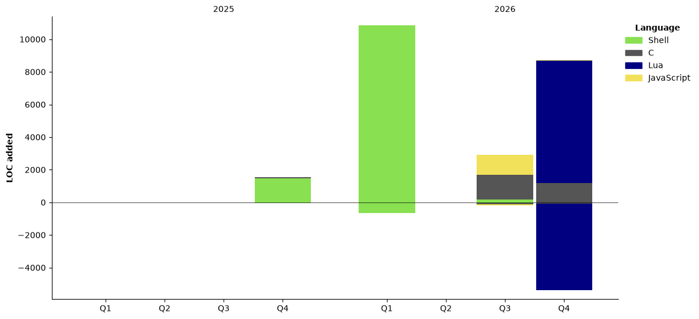

<p align="left">

  

  
  

  <h3><strong>Greeting, I'm LausMirus.</strong></h3>
  <p>✨ Just a <a href="https://www.google.com/search?q=graphite+artist">Graphite Artist</a>, exploring Linux and networking, still a beginner in coding, with every experiment revealing something new.i am obsessed with <strong>Dark Academic</strong> and <strong>chess</strong>. Every day, I fight for my life trying to figure out what Linux is actually doing under the hood, and test my mental patience by playing Valorant with random brain-dead teammates.✨
  
</p >

___

<p align ="center">
  
[](https://www.instagram.com/nripan_official?igsh=OGRwenZwbWlkcTZ3)  [](https://github.com/LausMirus)
</p>

___


<h4 align:"left">$ code.log </h4>

<!--START_SECTION:waka-->

```txt
From: 14 November 2026 - To: 15 November 2026

Total Time: 55 mins

Python   18 mins               ████████▓░░░░░░░░░░░░░░░░   34.09 %
YAML     17 mins               ████████░░░░░░░░░░░░░░░░░   32.46 %
Lua      13 mins               ██████░░░░░░░░░░░░░░░░░░░   24.37 %
C        5 mins                ██▒░░░░░░░░░░░░░░░░░░░░░░   09.08 %
```

<!--END_SECTION:waka-->
<!--START_SECTION:devmetrics-->


**🐱 My GitHub Data** 

> 📦 115.3 kB Used in GitHub's Storage 
 > 
> 🏆 443 Contributions in the Year 2026
 > 
> 💼 Opted to Hire
 > 
> 📜 13 Public Repositories 
 > 
> 🔑 5 Private Repositories 
 > 
**I'm an Early 🐤** 

```text
🌞 Morning                140 commits         ██████░░░░░░░░░░░░░░░░░░░   23.57 % 
🌆 Daytime                183 commits         ████████░░░░░░░░░░░░░░░░░   30.81 % 
🌃 Evening                226 commits         ██████████░░░░░░░░░░░░░░░   38.05 % 
🌙 Night                  45 commits          ██░░░░░░░░░░░░░░░░░░░░░░░   07.58 % 
```
📅 **I'm Most Productive on Sunday** 

```text
Monday                   49 commits          ██░░░░░░░░░░░░░░░░░░░░░░░   08.25 % 
Tuesday                  28 commits          █░░░░░░░░░░░░░░░░░░░░░░░░   04.71 % 
Wednesday                127 commits         █████░░░░░░░░░░░░░░░░░░░░   21.38 % 
Thursday                 75 commits          ███░░░░░░░░░░░░░░░░░░░░░░   12.63 % 
Friday                   37 commits          ██░░░░░░░░░░░░░░░░░░░░░░░   06.23 % 
Saturday                 76 commits          ███░░░░░░░░░░░░░░░░░░░░░░   12.79 % 
Sunday                   202 commits         █████████░░░░░░░░░░░░░░░░   34.01 % 
```


📊 **This Week I Spent My Time On** 

```text
🕑︎ Time Zone: Asia/Kolkata

💬 Programming Languages: 
Python                   18 mins             █████████░░░░░░░░░░░░░░░░   34.09 % 
YAML                     17 mins             ████████░░░░░░░░░░░░░░░░░   32.46 % 
Lua                      13 mins             ██████░░░░░░░░░░░░░░░░░░░   24.37 % 
C                        5 mins              ██░░░░░░░░░░░░░░░░░░░░░░░   09.08 % 

🔥 Editors: 
Neovim                   52 mins             ████████████████████████░   94.68 % 
Unknown Editor           2 mins              █░░░░░░░░░░░░░░░░░░░░░░░░   05.32 % 

🐱‍💻 Projects: 
LausMirus                36 mins             █████████████████░░░░░░░░   66.55 % 
hypr                     13 mins             ██████░░░░░░░░░░░░░░░░░░░   24.37 % 
Unknown Project          5 mins              ██░░░░░░░░░░░░░░░░░░░░░░░   09.08 % 

💻 Operating System: 
Linux                    55 mins             █████████████████████████   100.00 % 
```

🤖 **AI Coding This Week** 

```text
No AI Coding Activity Tracked This Week
```

**I Mostly Code in Shell** 

```text
Shell                    5 repos             ██████████████░░░░░░░░░░░   55.56 % 
C                        2 repos             ██████░░░░░░░░░░░░░░░░░░░   22.22 % 
JavaScript               1 repo              ███░░░░░░░░░░░░░░░░░░░░░░   11.11 % 
Lua                      1 repo              ███░░░░░░░░░░░░░░░░░░░░░░   11.11 % 
```


**Timeline**




 Last Updated on 15/11/2026 21:40:01 UTC
<!--END_SECTION:devmetrics-->
___

<!-- =================================[stats]================================= -->
<!-- 
[](https://github.com/ashutosh00710/github-readme-activity-graph)

-->

<p align="center">

  

</p>

___


<p align="center">
  
</p>
<h6 align="right">Quote by : LausMirus</h6>

<!--

<p align="center">
  


</p>
-->
___

<p align="center" >
 
</p>

___
